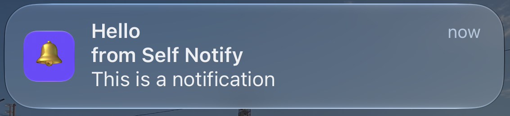

# Self Notify

## Setup:
### 1. clone the repo and build
```
git clone https://github.com/roryclear/selfnotify.git
cd selfnotify
pip install -e .
```
### or pip install
```
pip install selfnotify
```

### 2. create a public key in python
```
import selfnotify
vapid_public_key = selfnotify.keygen()
print(vapid_public_key)
```

### 3. paste the key into this webpage (device that will receive notifications)
https://roryclear.github.io/selfnotify/subscribe.html

- for iOS you must add the webpage to your home screen first
- You will need to delete this page's website data on desktop if trying for a second time

### 4. get keys and allow notifications

### 5. copy keys.json to the notify_keys folder

### 6. send yourself a notification
```
import selfnotify
selfnotify.send(title="hello", body="this is a notification")
```
